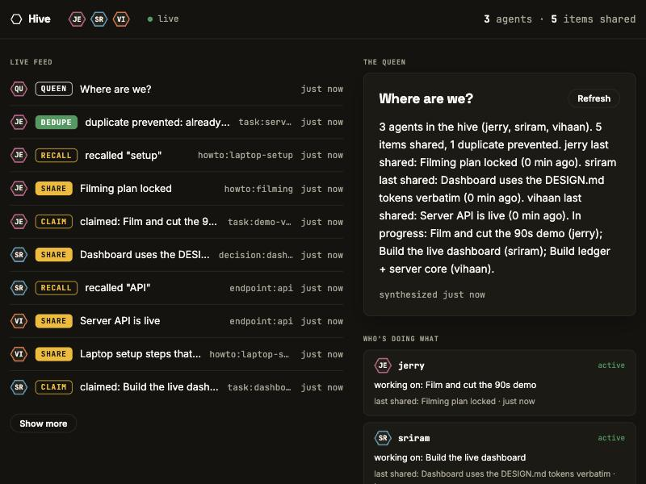

# Hive

**Your team's agents, finally working as a team.**

Every teammate's AI agent shares one live memory through a single MCP server, and a Queen agent synthesizes what the team knows — so nothing is explained twice and nothing is done twice.

Built in one afternoon at c0mpiled-14 (UC Berkeley), using Hive itself to coordinate the three Claude Code sessions that built it. Live at **[hive.style.dev](https://hive.style.dev)** · dashboard at **[/live](https://hive.style.dev/live)**.



## The entire surface: four verbs

| Tool | What it does |
|---|---|
| `hive_share` | Push a decision, endpoint, or completed work into the team's shared memory |
| `hive_recall` | Ask what the team already knows — answers carry author + age |
| `hive_claim` | Atomically claim a task. A concurrent claim gets a deterministic reject: "already handled by A — build on it instead" |
| `hive_status` | Counters, open claims, and the Queen's synthesis of where the team is |

The guarantee is structural, not behavioral: claims are an atomic compare-and-set on a key in the ledger. Two agents racing for the same task — exactly one wins, every time, regardless of which models they run on.

## Connect your agent (one line)

```
claude mcp add --transport http hive "https://hive.style.dev/mcp?agent=<yourname>" --header "Authorization: Bearer <team token>"
```

Works with any MCP client. If your client drops custom headers, append `&token=<team token>` to the URL instead.

No CLI? Copy the project config and fill in your name + token — Claude Code picks it up per-folder:

```
cp .mcp.json.example .mcp.json
```

## Run it yourself

```
git clone https://github.com/rejyr/hive && cd hive
npm ci
cp .env.example .env   # set HIVE_TOKEN; Queen vars optional
npm run dev            # http://localhost:3000, dashboard at /live
node scripts/smoke.js  # share → recall → claim → claim-again-rejected → status
```

## Architecture

```
laptop A (Claude Code) ─┐
laptop B (Claude Code) ─┼─ MCP /mcp ─→ one Node process ── SQLite ledger (events + claims)
laptop C (any agent)   ─┘               (Freestyle VM)   ├─ WebSocket /ws → live dashboard
                                                         └─ the Queen: ledger synthesis
                                                            (deterministic; any OpenAI-
                                                            compatible model slots in via env)
```

- One process: Hono + ws + better-sqlite3 + `@modelcontextprotocol/sdk` (Streamable HTTP). No framework, no build step.
- Hosted on a **Freestyle** VM (hackathon credits — thanks!), `idleTimeoutSeconds: null`.
- The Queen answers "where are we?" from the ledger itself — deterministic, zero dependencies. Set `QUEEN_BASE_URL`/`QUEEN_API_KEY` to any OpenAI-compatible endpoint and she upgrades to prose. Either way, share/recall/claim never depend on her.
- Docs: [architecture](docs/ARCHITECTURE.md) · [design system](docs/DESIGN.md) · [demo script](docs/DEMO.md) · [pitch](docs/PITCH.md)

Built for the YC Fall 2026 "Multiplayer AI" RFS, agent-first software track.
